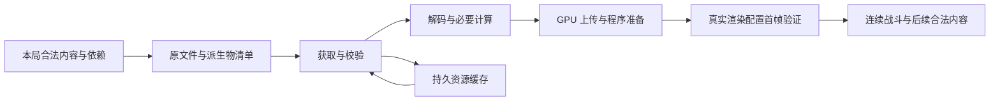

# MVP 7B 全局性能准备

日期：2026-10-15。当前阶段：研究与验收设计。依据用户“仅探索”“结合别人成熟方案”“先考虑全局最优，再考虑局部最优，为 7B 做充足准备”的要求整理。候选详解与外部依据见[方案与来源](MVP7B_PERFORMANCE_CANDIDATES_SOURCES_20261015.md)。

存档确认：2026-10-15，用户要求“先存档吧”。本文件与候选来源附录作为本轮研究存档，暂不启动优化实施。后续进入 7B 时从这里恢复，先结合包 6 合流后的完整内容建立全局基线，再筛选候选；此次存档不表示批准全部方案或性能验收通过。

## 推荐方向

**优先研究现有 Three/WebGL2 下的整体组合：本局完整依赖提前就绪、紧凑资源驻留、制作期预处理、受控准备流水线，再按整帧瓶颈选择局部优化。** 这样可以同时检验开局等待、后续关卡连续性、战斗帧时间和内存峰值。压缩纹理、CPU Worker、渲染 Worker、WebGPU 和质量自适应都有进入条件，不直接成为实施清单。

这里的“全局最优”是当前约束下有证据支持的最佳取舍。静态代码和外部案例不能证明数学意义上的最优，也不能推算本项目的加速百分比。先排除违反约束的方案，再比较整体收益；两套方案各有优势时，保留取舍，不用任意权重掩盖问题。

正式顺序保持 **1 → 3 → 2 → 6 → 7B → 8**。现在完成研究和实验设计，完整内容性能基线在 6 合流冻结后建立。此次只新增准备文档和导航，没有修改运行代码、资源、依赖、构建、部署或执行新基准。

## 共同约束与预算

已有范围以[MVP 收尾合同](MVP_COMPLETION_CONTRACT_20261013.md)、[五图确认](MVP5_ACCEPTANCE_NEXT_20261014.md)和最新舰装定案为准。

| 项目 | 选择方案时必须保留的条件 |
| --- | --- |
| 玩法与规模 | 保留当前规则、合法内容、队伍和效果，不通过减少敌人、限定原本合法的成长或改模拟频率获得通过 |
| 关卡连续性 | 普通第二关及后续合法内容不能突然补资源等待；不能以玩家一定停留够久为前提 |
| 视觉 | 冻结已接受五图及原始表现；只复验优化影响的部分和明显显示错误，不重开全套风格比较或客户端逐帧校准 |
| 完整准备 | 当前出征全部可达依赖无缺漏、首次使用无资源阻塞，包括后续单位、形态、死亡、子机、生产、事件和装备触发；不等于无差别装入所有种族、地图和模式 |
| 原有实现 | 复用真实 HDR／首帧预热、共享图像、GPU 姿态、已有缓存和后台调度等底座，不重复“新增”已实现能力 |
| 保存边界 | 沿用“存档 MVP 收尾前不考虑”；性能研究不新增存档迁移入口门槛，最终状态／恢复仍按收尾安排完成 |
| 交付 | Web 和实际具名离线 HTML 分别验证；CPU 解析产物释放后仍有明确的上下文恢复来源 |

预算是多项同时约束，不能用某一项的改善抵消另一项越线。

| 预算 | 既有起点或待锁定项 | 正确口径 |
| --- | --- | --- |
| 普通游玩 | Ryzen 7 5800U／Radeon，1440×900，DPR 1，原画质 | 1280×720 短测不能替代参考环境 |
| 60 Hz 帧时间 | 合同拟沿用 P95≤16.9 ms、P99≤20 ms、>20 ms 帧≤1% | 正式测量前锁定；不能测后放宽；60 Hz 只支持接近 60 的结论 |
| 模拟欠账与主线程 | 180 秒新增欠账≤0.1 秒且不持续累积；主线程 P95 目标≤14 ms | 保留真实 tick、丢弃时间和输入记录，不用只看平均 FPS 代替 |
| 战斗资源长任务 | 连续战斗不反复出现资源准备造成的 >50 ms 长任务 | 同时记录 16.9–50 ms 的超预算帧，长任务为零不等于 60 FPS |
| 加载 | 导航→可操作菜单、开始→可操作战斗、端到端等待、再次进入；数值待锁定 | 15 秒开场准备与 20 秒停止新任务是调度设计，不能解释为菜单 SLA 或百秒等待可接受 |
| CPU 常驻与瞬时峰值 | 按设备待定 | 分别列网络字节、解析树、解码图像、数组、Worker/WASM、缓存写入和上传暂存的重叠 |
| GPU 驻留与峰值 | 按设备待定 | 分开内容资源和随像素数增长的 HDR、深度、后处理目标；记录新旧资源交接 |
| 持久资源缓存 | 按可用存储与版本策略待定 | 独立于运行内存；配额不是可用空间承诺，驱逐后仍须有正确路径 |
| 手机与持续性能 | 真实 iPhone 17 Pro Safari 已报告入场问题；版本、预算和支持范围待锁定 | 原因未确认；桌面窄屏和桌面 WebKit 不替代真机，没有通用“Safari 2 GB”判线 |

WebGL 没有可移植的最大显存查询。应使用资源逻辑字节、对象生命周期及实际设备表现共同判断；JS 堆、进程内存、GPU 估算在统一内存设备上不能简单相加成精确物理占用。[MDN WebGL 指南](https://developer.mozilla.org/en-US/docs/Web/API/WebGL_API/WebGL_best_practices)

## 当前证据与缺口

最近正式设置交付为[应用 0.6.28](MOBILE_SETTINGS_VALIDATION_20261014.md)，沿用 0.6.27 已接受五图的同一资源版本。新增舰装与趣味内容尚需按既定阶段接入；旧性能成绩不自动成为最终全内容成绩。

| 已有证据 | 可以复用 | 不能据此推断 |
| --- | --- | --- |
| [7A 验证](MVP7A_LOADING_VALIDATION_20261013.md)：74 个入口／战斗记录 | Web／真实 HTML、首次／重进、0／15／30 秒停留、正式计时与重型 profile 分离的方法 | 所有条件都重复三次、当前完整内容或真实 Safari 已通过 |
| 同份记录：184 模型数值比较、40 对固定状态、两轮地图对象留存 | 版本绑定、数值一致与生命周期检查方法 | GPU 物理内存、无泄漏证明或新装备正确性 |
| 7A 重型 profile：714 次 getProgramInfoLog 约 68.052 秒，姿态准备约 1.520 秒 | 编译同步点值得优先归因；姿态预处理不应被说成消除百秒开局的唯一方案 | 能直接省掉 68 秒；嵌套区间可相加；桌面结论等于 Safari 原因 |
| 7A 多组真实战斗 P95 约 33 ms | 保留未达目标的事实与原始失败 | 稳定 60 FPS、连续存活 180 秒或完整自然战役已通过 |
| [10 月 6 日固定场景](FIXED_SCENE_PERFORMANCE_VALIDATION_20261006.md) | 同机串行、同快照、三次重复和逻辑一致检查方法 | 高生命静止靶场等于自然攻击负载 |
| [五图实现与验证](MVP5_FULL_MAP_20261014.md) | 环境成本与已接受外观基线 | 独立地形页成绩代表主游戏完整战斗 |
| [设置交付](MOBILE_SETTINGS_VALIDATION_20261014.md) | 预下载、全屏、方向切换与原有验证 | Safari 入场问题已修复；预下载完成等于 GPU 已就绪 |

**优先补测量口径，再补优化代码。** 当前 `BattleRenderer.report()` 直接读取 `renderer.info.render.calls/triangles`，而当前 Three 默认每次 `render()` 重置统计；项目没有设置 `info.autoReset=false`。结合多道后处理，可推断该字段不能直接当作整帧统计，可能仅反映最后的 OutputPass。7B 应按一个逻辑帧显式汇总，再检查其开销。相关代码：[报告与渲染入口](../../src/render/scene/battle-renderer.ts)、[Three 的统计实现](../../node_modules/three/src/renderers/webgl/WebGLInfo.js)。这不是对历史帧时间实测的撤销，而是对 draw calls／triangles 解释范围的校正。

## 三张全局图

### 从导航到连续战斗的关键路径

每个节点记录开始、结束、等待原因、独占或共享资源、在途字节和持有者。区分“必须做的工作”“重复做的工作”“能搬到制作期的工作”“可与其他工作重叠的工作”。完成时间由依赖图的关键路径决定，不能把嵌套 profiler 区间相加，也不能把工作移入菜单停留后称为总等待减少。

当前只有局外可以换装，因此出征时可以固定该次舰装配置，但仍需覆盖局内全部合法生成、随机事件和单位。依赖闭包以规则推导为主，运行见证负责发现漏项。不能从“本次视频没遇到”推断资源不可达；普通流程共享的碉堡等内容也不能仅凭目录名被整包删去。

### 资源从原件到释放的生命周期

只读原素材 → 带来源版本的派生发布物 → 网络或内嵌字节 → 解码图像／CPU 几何／姿态 → GPU 资源。持久缓存是另一个存储层，不是 GPU 就绪状态。

每层记录唯一身份、逻辑字节、持有者、共享关系、释放条件、上下文丢失后的重建来源。整局公共依赖稳定持有，临时解析副本在确认没有引用后释放；保持既有地图对象的受控生命周期，不强制所有场景对象永远驻留。Unity Addressables 对加载／释放配对和反复卸载重载的分析可作为所有权设计参考。[官方内存管理](https://docs.unity3d.com/Packages/com.unity.addressables@1.21/manual/MemoryManagement.html)

完整准备是无缺依赖和首次使用无资源阻塞的合同，不要求所有场景对象、临时解析副本同时常驻。若新方案释放后还需在战斗中重新上传或编译，必须满足下文 E 的额外验证条件，不能把文件已缓存写成 A 已就绪。

准备调度同时限制任务数和在途字节，不能只把并发数开大。下载、解析、转码、缓存写入、上传若同时持有整份数据，峰值会高于稳定驻留。Streams 的 `tee()` 并不能保证慢分支队列有界，因此双路消费还需单独设计背压。[MDN tee](https://developer.mozilla.org/en-US/docs/Web/API/ReadableStream/tee)

### 一帧的提交与像素成本

当前应纳入同一成本图的链路是：模拟和 HUD → 阴影准备／姿态深度／contact → 主场景 HDR 与透明效果 → 活跃折射场及合成 → bloom → ACES／sRGB 输出。具体执行和统计边界以实际 renderer 调用为准。

每道记录 CPU 提交、GPU 区间、draw calls、三角形、纹理／缓冲上传、附件尺寸与格式、读写依赖、透明重叠。CPU 和 GPU 可能重叠也可能互相等待，整帧耗时不能机械等于两者之和。全屏后处理和带宽成本不能仅靠单位面数判断。

可研究重复遍历、冗余附件和无必要的中间读写；不能改变 HDR→折射→bloom→输出顺序，提前废弃折射仍要读取的深度，或把只影响 ambient diffuse 的 contact 当作最终颜色乘法。移动 GPU 的 tile 资料支持带宽与生命周期分析，但 Vulkan 子通道能力不能直接搬到 WebGL；合并 pass 也可能降低调度效率。[Arm 的子通道取舍](https://developer.arm.com/community/arm-community-blogs/b/mobile-graphics-and-gaming-blog/posts/vulkan-subpasses-the-good-the-bad-and-the-ugly)

## 整体方案比较

| 方案 | 组合与潜力 | 主要代价 | 进入条件 |
| --- | --- | --- | --- |
| A 完整准备与紧凑驻留 | 本局完整依赖、程序清单、制作期派生、共享与临时副本释放、有界调度；兼顾开局、连续性与峰值 | 准备总工作仍需完成；派生物可能增加传输；需可靠恢复来源 | **优先主线**，先测现有瓶颈和资源账本 |
| B A＋GPU 压缩纹理 | 可能同时降低传输、上传与纹理驻留 | 转码启动、Worker/WASM 峰值、不同 GPU 格式和视觉差异 | 纹理确为主要压力，代表纹理与设备样本证明收益后再扩展 |
| C A＋有界 CPU Worker | 解析、解包或确定性派生计算离开主线程，改善交互长任务 | 消息、所有权转移、重复缓存与并发峰值 | CPU 长任务占比足够；不承诺缩短主上下文驱动等待 |
| D A＋整帧提交／附件优化 | 降低重复场景遍历、上传、全屏读写与透明像素成本 | 合批影响剔除；合并改变依赖或混合次序；深度仍有使用者 | 整帧 profile 指向提交或像素带宽；候选维持既有画面 |
| E 完整文件准备＋分阶段 GPU 驻留 | 可降低常驻，适合更大内容集合 | 后续上传／编译侵占战斗预算，可能重新出现第二关卡顿 | 暂不作默认；只有所有合法路径、最快推进和目标设备均提前就绪且战斗不退步才考虑 |
| F OffscreenCanvas 渲染 Worker | 分离 DOM 与渲染 JS 的主线程争用 | 输入、拾取、World 快照、尺寸、生命周期消息协议；GPU 成本不消失 | 提交主导且小范围原型证明净收益，当前较轻方案不足 |
| G WebGPU／TSL 或原生迁移 | 可能改善特定提交负载，并提供新的 GPU 能力 | 当前自定义材质、姿态深度、折射及后处理重做；设备与交付合同扩大 | 后置架构选项，须先证明现有架构上限与投入必要性 |
| H 质量档位与自适应 | 在支持设备和持续热状态下控制像素负载 | 改变画质、目标重建和频繁波动；不能解决模拟瓶颈 | 单独质量契约；保留原画质基线与已有手动档位，不自动降低模拟或单位数量 |

这不是八项全部实施的排期。A 是组织其余候选的主线，B/C/D 可能按瓶颈组合；E/F/G/H 只在条件满足时进入。Three 官方明确新 renderer 不能直接使用旧 `ShaderMaterial`、`onBeforeCompile` 和 `EffectComposer`，部分场景仍可能旧 WebGLRenderer 更快，所以“换 WebGPU 就解决”缺乏依据。[Three 迁移说明](https://threejs.org/manual/pages/webgpurenderer)

若没有任何候选同时满足设备预算与既定目标，应把具体冲突带入支持范围或质量档位的定案；不能偷偷减少合法内容，也不能先改变目标再报告通过。

## 局部研究队列与组合关系

局部项的详细代码入口、证据强度和实验判据在[候选目录](MVP7B_PERFORMANCE_CANDIDATES_SOURCES_20261015.md)。优先级表示研究顺序，不代表收益排序或实施授权。

| 顺序 | 要回答的问题 | 对应候选 |
| --- | --- | --- |
| P0 | 当前瓶颈在哪里，统计是否覆盖整帧和整局 | M0 测量口径；A1 依赖与程序清单；A2 资源所有权／字节账本 |
| P1 | 能否减少当前路径上的重复工作且保留画面 | R1 材质局部上传；A2 临时副本／环境图像共享；S1 真正重复的程序变体；R2 场景遍历与附件 |
| P2 | 能否用更小的运行准备成本承担完整内容 | A3 制作期派生；A4 KTX2；L1 有界 CPU Worker；C1 模拟／特效静态预处理；U1 UI 更新 |
| 条件项 | 网络、离线解包、缓存写入是否处在关键路径 | L2 离线分块与传输；L3 缓存写入；已有预下载的诊断 |
| 后置项 | 主线仍达不到目标时，哪种系统边界值得改变 | E 分阶段驻留、F 渲染 Worker、G WebGPU、H 明确质量档位 |

需要专门验证的相互作用：

- 程序变体收敛可能缩短准备，却增加每个像素的分支或采样；同时检查开局与战斗。
- 制作期姿态／LOD 派生减少 CPU 计算，却可能增加传输和常驻；同时检查冷开局与回访。
- 共享资源降低复制，但过早释放共享对象会造成重载或恢复失败；先明确持有者。
- KTX2 与 Worker 可以组合，转码输入、输出、WASM 和上传队列却可能同时抬高峰值。
- 更大合批减少提交，却可能使剔除更粗、透明排序更难；不能只比较 draw calls。
- 更高加载并发可能缩短某阶段，却恶化菜单交互、内存峰值或长局热状态。

收益不相加。局部候选入选后，少量必要组合重新测端到端；不展开所有开关的全排列。

## 测量与实验设计

### 正式指标与归因分开

正式构建使用轻量帧时间、阶段和状态记录；CPU profiler、GPU query、SpectorJS 捕获、堆快照各自串行运行。重型浏览器或基准不并发，避免把争用当成本项目退步。

GPU 查询先检测能力，延迟读取结果，遇 disjoint 丢弃该区间并保留原因；不能用 `performance.now()` 包住 `render()` 当 GPU 时间，也不为逐帧测量新增 `gl.finish()`。多 pass 不嵌套不允许嵌套的 elapsed query，整帧与分 pass 归因可分轮采集。[Khronos GPU timer 规范](https://registry.khronos.org/webgl/extensions/EXT_disjoint_timer_query_webgl2/)

Chrome LoAF 可归因超过 50 ms 的动画帧与交互长任务，但不能覆盖所有 60 FPS 预算违例；按能力启用，并保留独立 rAF、CPU 工作和模拟时钟记录。[Chrome LoAF](https://developer.chrome.com/docs/web-platform/long-animation-frames)

### 版本与样本

每个样本绑定源码／未提交改动、Web 或 HTML 实际哈希、资源 manifest、场景／种子／输入、装备配置、地图、视口、DPR、画质、浏览器／设备／刷新率、缓存来源、可见／焦点状态、供电与后台负载。未控制 OS 或驱动缓存就不能称其为冷态。

固定场景用于局部 A/B：同版本条件、同种子与输入或明确的当前版诊断状态，交替 A/B 与 B/A 顺序，每个正式比较场景至少三次。报告中位数、最差、范围及失败，不挑掉慢样本。差值落在自然波动内则记录“收益未证实”；只有新的机制证据能解释分歧时才补测。

受控回放或同输入配对要求 World／RNG／模拟时钟与规则结果一致。固定场景胜出后必须进入自然玩法，记录真实输入轨迹、负载、模拟欠账、尾帧和失败；不同自然局不要求相同 CRC。不能靠靶场、加生命、关闭效果或去掉首十秒获得正式通过。

### 有界场景矩阵

| 层次 | 覆盖 | 判定职责 |
| --- | --- | --- |
| 完整流程 | 三族自然十八关、特殊关往返、终章、无尽、主动撤离／战败；生产运输和换图贯穿 | 证明合法流程与真实负载，结合包 6／8 已需的完整记录复用，不新增每关每设备全排列 |
| 可重复性能 | 按原计划选三族 1–3 关 180 秒、4–6 关 225 秒、10–12／16–18／无尽各 180 秒代表段 | 每个锁定场景至少三次；无／中／高成型真实装备按机制选代表组合，旧天赋点夹具不能替代新装备 |
| 重点机制 | 首次英雄／精英、首次装备和事件效果、高成型子机、真实虫潮重叠 | 真实可达高负载不能一概豁免成极端压力；稀有机制可另用标注夹具补分支 |
| 加载 | 真实 Web 与具名 HTML；首次立即开始、同页重开、再次导航；0／15／30 秒停留 | 同时看菜单、点击后、总等待；缓存热态分类；玩家停留不作为通过前提 |
| 关卡连续性 | 第二关及后续首次合法资源、最快合法推进、特殊关返回 | 首次编译／上传／解码与长任务有归属；不能靠隐藏资源停顿通过 |
| 资源稳定 | 长局、重复换图、退出重进；加载峰值、稳态和回落 | 循环数与持续时间在正式测前锁定；现有两轮对象计数只作方法输入 |
| 设备与操控 | 参考 PC；真实报告机 iPhone 17 Pro Safari；其余已支持设备和物理输入按最终合同 | 仿真与真机分列；高刷新／低电量／长时热变化按相关风险抽样，不冒充全设备通过 |

旧 `tools/qa-ordinary-performance.mjs` 含开发版、短样本、warmup、旧天赋及 RNG 夹具，应借用工具能力并重设合同，不能原样充当 7B 验收。

长时观察要把关卡、设置与 CPU/GPU、帧时间趋势关联。Apple 的游戏性能方法值得借鉴，但 Metal、Instruments 和 StateReporting 是原生工具；Safari 页面没有相同观测能力时，记录会话时长、设备环境和表现趋势，不虚构热状态读数。[Apple 长局性能分析](https://developer.apple.com/videos/play/wwdc2026/388/)

## 推进门禁与停止条件

| 阶段 | 输出与进入下一步的条件 |
| --- | --- |
| G0 基线与合同 | 固定完整内容版本和探索性基线口径；基于基线锁定支持设备／档位、正式场景、计时边界和预算，之后开始正式候选比较 |
| G1 全局归因 | 三张图与关键路径，瓶颈占比、测量置信边界、所有权和峰值；先纠正统计缺口 |
| G2 组合筛选 | 选少数架构组合，写明收益机制、依赖、视觉／规则风险和反例 |
| G3 单项 A/B | 单变量小实验；同状态、同机串行、重复与失败保留；收益超出噪声且无约束违例 |
| G4 集成比较 | 重测关键路径、峰值、战斗尾帧、连续性和受影响画面；检查交互作用 |
| G5 正式验收 | 完整候选满足自然场景、真实设备和支持输入；结果交给包 8 的交付、用户试玩与生产验收 |

出现受控同输入配对的规则／RNG／模拟时钟差异、减少合法内容才达标、依赖漏项推迟到第二关、上下文恢复失败、崩溃、持续资源增长或已接受画面回退时，停止推进该候选，保留原始失败并分析原因。某项指标改善而另一已锁预算越线时，重新设计，不事后放宽预算。

历史否决也进入候选账本：[7A 候选取舍](MVP7A_LOADING_20261013.md)中的成功 shader log 跳过、提前 depth 编译、CPU-only 开场准备及缩短开场预算，都有等待转移、首十秒退步或内存代价；[固定场景记录](FIXED_SCENE_PERFORMANCE_VALIDATION_20261006.md)中材质程序键缓存／空批次跳过也已撤回。没有新的机制证据，不把旧失败换名当新收益。

## 正式实施前仍需锁定

| 决定 | 需要的输入 | 定案时间 |
| --- | --- | --- |
| 设备支持、默认画质与刷新率 | 实际可验证设备、报告机环境、既有支持承诺 | G0；不能测完后缩小范围 |
| 加载、菜单响应与资源峰值预算 | 当前完整内容轻量基线与目标体验 | G0；保留现有 60 FPS 方向，不预填任意 MB 或秒数 |
| 普通结束进入无尽的准备边界 | 最终模式切换规则及允许出现的明确过渡 | A1 清单完成前；不影响普通第二关连续性的既定要求 |
| 真实装备代表配置 | 最终共享规则、合法成型强度、子机与事件联动 | 包 6 冻结后；不沿用废弃九套或旧天赋点替代 |
| 长时与重复换图时长／次数 | 自然流程长度、资源趋势和真实设备风险 | 正式测量前，避免无限扩展测试 |
| 有损派生或画质变化的范围 | A/B 证据、受影响图像及可见取舍 | 进入相应候选前；不能混入等价优化成绩 |

当前研究交接已具备：整体方案比较、局部候选入口、成熟来源、测量缺口、实验顺序、有限验收矩阵与否决规则。下一步沿既定 MVP 顺序完成内容；进入 7B 时先产出 G0/G1 的全局基线，再决定实际实施哪些候选。
